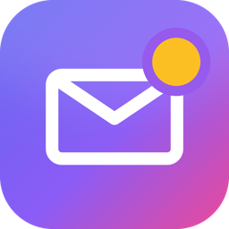
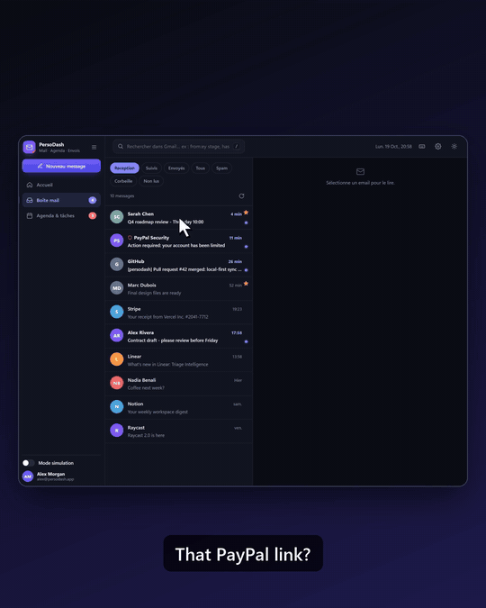
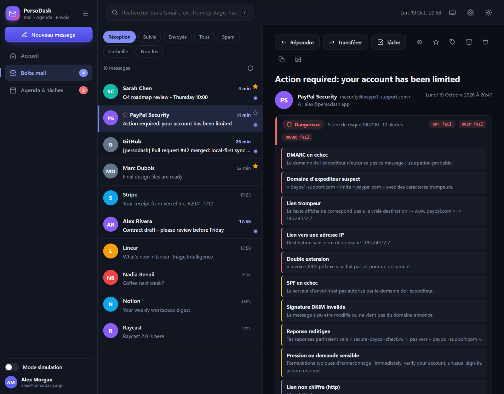
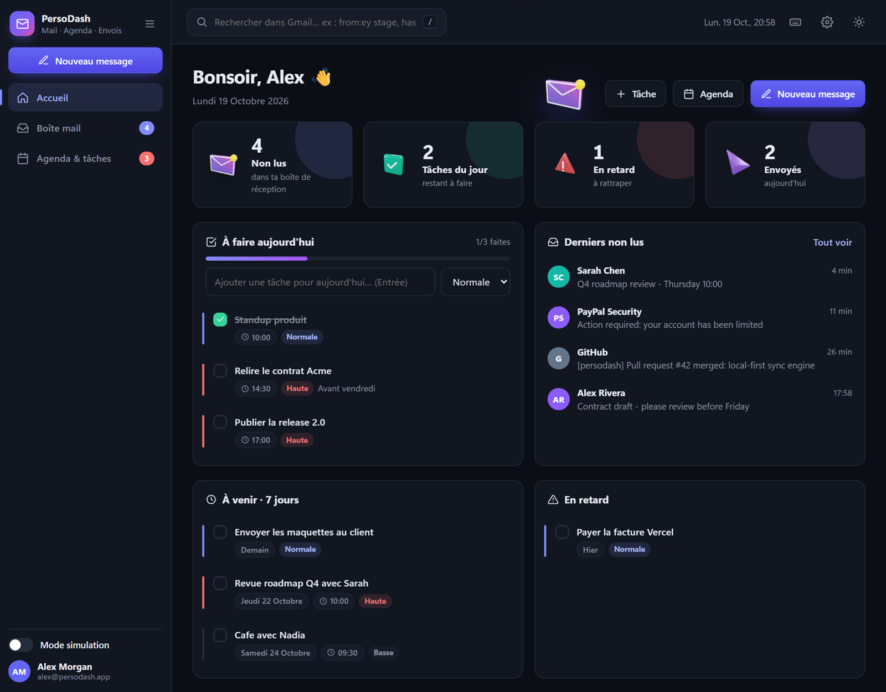
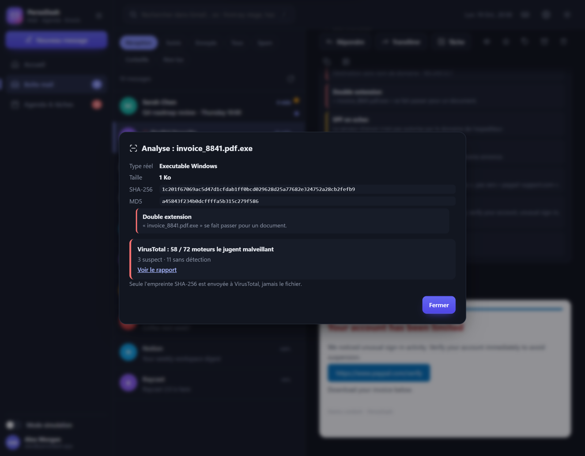
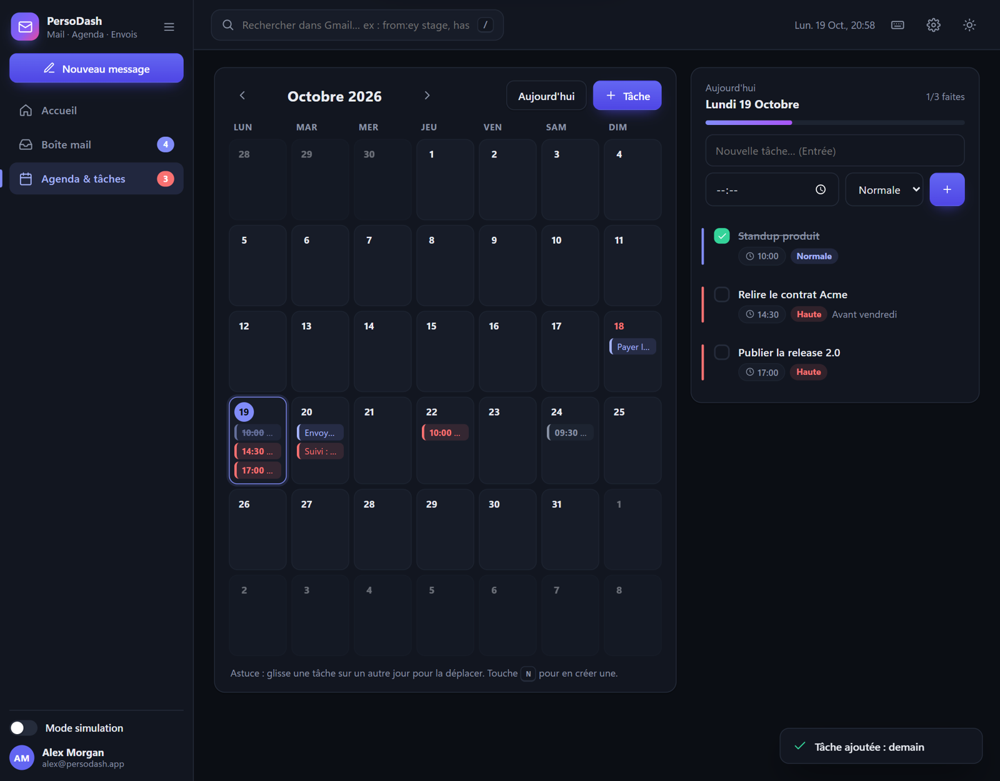
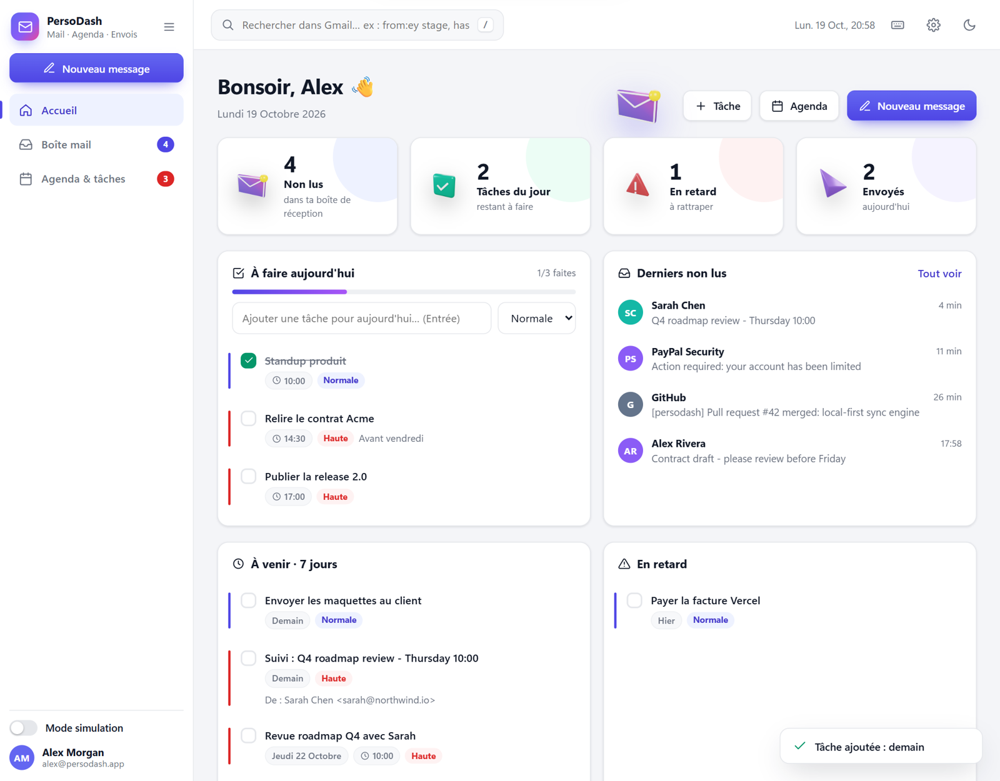

<p align="center"></p>

<h1 align="center">PersoDash</h1>

<p align="center"><b>Ta boîte Gmail, sur ton PC. Avec un détecteur de phishing intégré.</b><br>
<i>Your Gmail, on your machine — with a built-in phishing detector.</i></p>

<p align="center">
  <a href="https://github.com/EssidYassine/PersoDash/releases/latest"></a>
  
  
</p>

<p align="center"></p>

---

## Pourquoi PersoDash ?

Le phishing ne se repère plus à l'œil nu. Un faux PayPal ressemble au vrai à un caractère près (`paypa1`), un lien affiche une adresse et en ouvre une autre, et une « facture.pdf » peut être un programme.

**PersoDash analyse chaque email à ta place et te dit, en clair, s'il est sûr, suspect ou dangereux, et pourquoi.**

## Ce que fait l'app

| | |
|---|---|
| 🛡️ **Score de risque sur chaque email** | Vérification SPF, DKIM et DMARC (l'expéditeur est-il authentique ?), domaines sosies, liens trompeurs, liens vers une adresse IP, nom d'expéditeur usurpé, réponses détournées, formulations d'hameçonnage. Un badge **Sûr / Suspect / Dangereux** avec chaque alerte expliquée. |
| 🔍 **Pièces jointes passées au crible** | Le vrai type du fichier, d'après son contenu (un `.exe` déguisé en `.pdf` est démasqué), les doubles extensions, et la réputation **VirusTotal** consultée par empreinte : **le fichier n'est jamais envoyé**. |
| 📥 **Un vrai client mail** | Ta boîte Gmail : dossiers, recherche Gmail, répondre, transférer, archiver, étoiles, libellés, pièces jointes avec aperçu. |
| 📅 **Agenda et tâches intégrés** | Un email devient une tâche en une touche (`T`). Calendrier, priorités, rappels, glisser-déposer. |
| 🔔 **Notifications Windows** | Nouveaux emails et rappels de tâches, même fenêtre fermée (l'app reste près de l'horloge). |
| 🔐 **Ta vie privée d'abord** | Tout tourne **sur ton ordinateur** : aucun serveur intermédiaire, aucun abonnement, aucun pistage. Ton mot de passe est rangé dans le **coffre chiffré de Windows**, jamais dans un fichier. Les images espions peuvent être bloquées. |
| 🧠 **Brain : vide ta tête** | Capture tes idées et tâches sans date en une seconde, puis glisse-les sur les jours du calendrier. |
| 🎯 **Objectifs** | Tes grands buts avec échéance ; la progression se calcule toute seule à partir des tâches liées. |
| 📝 **Notes et carte façon Obsidian** | Notes Markdown reliées par des liens `[[Titre]]`, et une carte interactive qui montre comment tâches, notes et objectifs sont connectés. |
| 🔒 **Verrouillage par code** | Code demandé à l'ouverture, après inactivité ou avec `Ctrl+L`. Appliqué par l'app elle-même, pas seulement à l'écran ; notifications masquées quand elle est verrouillée. |
| 🎨 **Ton thème, ton style** | 6 ambiances (Clair, Sombre, Minuit, Forêt, Nord, Sépia), la couleur d'accent de ton choix, fond aurore, raccourcis clavier. |

## Aperçu

<p align="center"></p>

| Accueil | Analyse d'une pièce jointe |
|---|---|
|  |  |
| **Agenda** | **Thème clair** |
|  |  |

*Captures réalisées avec le mode démo de l'app (données fictives).*

## Installation (2 minutes)

1. **Télécharge** `PersoDash-Setup-1.1.0.exe` depuis la page [**Releases**](https://github.com/EssidYassine/PersoDash/releases/latest).
2. **Lance-le.** Pas besoin d'être administrateur : l'app s'installe pour ton compte, avec une icône sur le Bureau et dans le menu Démarrer.
   > Windows peut afficher « Windows a protégé votre ordinateur » : c'est normal pour une app récente qui n'est pas encore signée numériquement. Clique sur **Informations complémentaires**, puis sur **Exécuter quand même**.
3. **Au premier lancement**, PersoDash te guide pour connecter Gmail :
   - active la [validation en 2 étapes](https://myaccount.google.com/signinoptions/twosv) de ton compte Google ;
   - crée un [mot de passe d'application](https://myaccount.google.com/apppasswords) (un code de 16 lettres, réservé à PersoDash, que tu peux révoquer à tout moment) ;
   - colle-le dans l'app. Il est vérifié auprès de Gmail, puis rangé dans le coffre de Windows.

**Juste pour essayer, sans compte Gmail ?** Menu Démarrer → **PersoDash (mode démo)** : une boîte et un agenda fictifs pour tout découvrir.

## Vérifier le fichier téléchargé (recommandé)

Pour t'assurer que l'installeur n'a pas été modifié, compare son empreinte SHA-256 à celle publiée avec chaque version. Dans PowerShell :

```powershell
Get-FileHash .\PersoDash-Setup-1.1.0.exe -Algorithm SHA256
```

Le résultat doit être identique à celui indiqué dans les [notes de version](https://github.com/EssidYassine/PersoDash/releases/latest).

## Configuration requise

- Windows 10 (version 1809 ou plus récente) ou Windows 11, 64 bits
- Un compte Gmail avec la validation en 2 étapes
- Environ 150 Mo d'espace disque

## Désinstaller

*Paramètres Windows → Applications → PersoDash → Désinstaller.* Tes réglages et ton agenda restent dans `%APPDATA%\PersoDash` (supprime ce dossier pour tout effacer). Pour retirer le mot de passe : *Gestionnaire d'identifiants Windows → PersoDash*.

## Questions fréquentes

**Mes emails passent-ils par un serveur PersoDash ?** Non. L'app parle directement à Gmail depuis ton PC. Il n'existe aucun serveur PersoDash.

**Pourquoi un « mot de passe d'application » ?** C'est la méthode officielle de Google pour connecter un logiciel de messagerie sans lui confier ton vrai mot de passe. Tu peux le révoquer à tout moment.

**Et Outlook, Yahoo… ?** Seul Gmail est pris en charge pour le moment.

**Le code est-il disponible ?** Non, PersoDash est distribué gratuitement sous forme d'application (voir [LICENSE](LICENSE.md)).

## Contact

Une question, une idée, ou tu veux PersoDash pour ton équipe ? Écris-moi sur [LinkedIn](https://www.linkedin.com/in/) ou ouvre une [discussion](https://github.com/EssidYassine/PersoDash/issues).

<p align="center"><sub>Fait avec soin par <b>Essid Yassine</b>, étudiant ingénieur en cybersécurité.</sub></p>
